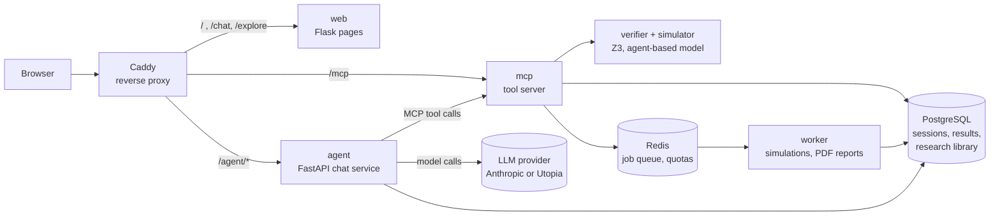
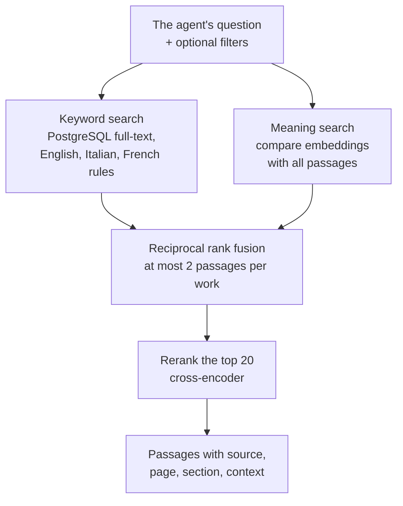

# Token Economy Verifier

A pre-deployment checker for community token economies: local and
complementary currencies, time banks, reward tokens, DAO tokens and similar
systems. You describe a design, either by talking to a chat assistant, by
filling in a questionnaire, or by writing a YAML file. The tool then checks
it against the **six failure modes** defined in the DLT2026 paper *Six
Failure Modes: A Pre-Deployment Diagnostic Framework for Tokenized
Collaborative Economies* (Domenicale, Avanzo, Schifanella):

| # | Failure mode | What goes wrong | Violation condition |
|---|---|---|---|
| FM1 | Token oversupply / inflation spiral | More tokens are issued than the activity they pay for can absorb | `E(t) > P·Q/V` |
| FM2 | Velocity trap | Tokens are spent as soon as they arrive; nobody has a reason to hold them | `τ̄ → 1` |
| FM3 | Burn/emission imbalance | Tokens are removed far more slowly than they are created | `E(t) − B(t) > g(t)·M(t)` |
| FM4 | Free-rider / contribution collapse | Taking without contributing pays better than contributing | `φ < d/K` or `γS ≤ T − R` |
| FM5 | Insufficient critical mass | Too few participants to find a counterpart for each need | `N < 2Kd + 1` |
| FM6 | Governance capture | A few actors take most decisions alone | `Γ > 0.5` |

Verification runs in two stages, formal methods first:

1. **Static (formal) check.** The [Z3 SMT solver](https://github.com/Z3Prover/z3)
   decides each failure mode over all values your description allows. A
   failed check comes with a **counterexample**: concrete values that make
   your design fail.
2. **Dynamic check (simulation).** An agent-based simulation produces
   trajectories over time, Monte Carlo probabilities of failure and network
   views. It is used when the static check cannot decide, or when you want
   concrete numbers over time.

On top of the verifier, an **assistant platform** adds a chat agent that
interviews the designer, runs the checks and simulations through tools,
searches a curated **research library** (retrieval-augmented generation,
RAG) for evidence and remedies, and writes a PDF report with sources.

---

## Contents

- [How the system fits together](#how-the-system-fits-together)
- [Quick start: verifier only (no chat)](#quick-start-verifier-only-no-chat)
- [Full platform with the chat assistant](#full-platform-with-the-chat-assistant)
- [Using the app](#using-the-app)
- [The chat assistant](#the-chat-assistant)
- [The research library (RAG)](#the-research-library-rag)
- [Where data is stored](#where-data-is-stored)
- [Command-line tools](#command-line-tools)
- [Tests and evaluations](#tests-and-evaluations)
- [Troubleshooting](#troubleshooting)
- [Repository layout and further documentation](#repository-layout-and-further-documentation)
- [References](#references)

---

## How the system fits together



| Part | What it does | Code |
|---|---|---|
| **Verifier** | The six failure-mode checks (Z3), the agent-based simulator, the spec schema (TE-IR) and its expression language | `verifier/`, `schema/` |
| **web** | The browser pages: questionnaire, simulation explorer, YAML editor, chat page, login | `webapp/` (Flask + Jinja2 templates, plain JavaScript) |
| **agent** | Runs the conversation: sends the messages to the language model, executes the tools it asks for, streams the answer to the browser | `te_platform/agent/` (FastAPI) |
| **mcp** | The tool server. Every action the agent can take (validate, verify, simulate, search the literature, render a report) is a tool behind one pipeline that checks inputs, permissions, quotas and preconditions | `te_platform/mcp_server/`, `te_platform/tools/`, `te_platform/registry/`, `policy/` |
| **worker** | Runs long jobs in the background: Monte Carlo simulations, experiments, PDF reports | `te_platform/jobs/` |
| **PostgreSQL** | Users, chat sessions, spec versions, verification results, reports, the audit log and the research library | `te_platform/db/` |
| **Redis** | Job queue and rate limits; keeps nothing on disk | `te_platform/jobs/`, `te_platform/security/quotas.py` |
| **Caddy** | Single entry point; HTTPS in production, security headers, rate limits | `deploy/caddy/` |

The tool server speaks the [Model Context Protocol (MCP)](https://modelcontextprotocol.io/),
so any model the platform supports, and any external MCP client with an API
key, sees exactly the same tools.

---

## Quick start: verifier only (no chat)

This runs the questionnaire, the simulation explorer and the YAML editor in
one container. It needs no database, no model and no API key.

### With Docker (recommended)

Install [Docker Desktop](https://docs.docker.com/desktop/) (macOS,
Windows) or [Docker Engine](https://docs.docker.com/engine/install/) (Linux),
and [Git](https://git-scm.com/downloads). Then:

```bash
git clone https://github.com/SoweluAvanzo/TE-verifier.git
cd TE-verifier
docker build -t token-economy-verifier .
docker run --rm -p 8000:8000 --name te-verifier token-economy-verifier
```

Open **<http://localhost:8000>**. Stop it with `Ctrl+C`, or
`docker stop te-verifier` from another terminal. If port 8000 is taken, use
`-p 8080:8000` and open <http://localhost:8080>. After changing the code,
run `docker build` again.

### With Python

Python **3.11 or newer** is required (3.12 recommended). Every dependency,
including Z3, installs as a prebuilt wheel, so no C compiler is needed.

```bash
git clone https://github.com/SoweluAvanzo/TE-verifier.git
cd TE-verifier
python3.12 -m venv .venv
source .venv/bin/activate              # Windows: .venv\Scripts\Activate.ps1
python -m pip install --upgrade pip
python -m pip install -e ".[webapp,dev]"
flask --app webapp.app run --port 5001
```

Open **<http://127.0.0.1:5001>**. Port 5001 is used because macOS uses 5000
for AirPlay Receiver. On macOS, install Python 3.12 with
[Homebrew](https://brew.sh) (`brew install python@3.12`): the system
Python is too old.

---

## Full platform with the chat assistant

The platform runs as seven containers with Docker Compose. It needs Docker
Engine 25 or newer (Docker Desktop includes it) and a key for a language
model, either from [Anthropic](https://console.anthropic.com/) or from an
OpenAI-compatible service such as the University of Turin's
[Utopia](https://utopia.hpc4ai.unito.it/).

### 1. Settings and secrets

Non-secret settings live in `.env`; passwords and keys live as files in
`secrets/`. Both are git-ignored and never leave your machine.

```bash
cp .env.example .env && chmod 600 .env

install -d -m 700 secrets
for f in db_admin_password db_app_password db_migrator_password; do
    openssl rand -hex 24 > secrets/$f
done
printf 'postgresql+psycopg://te_migrator:%s@postgres:5432/te' \
    "$(cat secrets/db_migrator_password)" > secrets/te_migration_database_url
printf 'postgresql+psycopg://te_app:%s@postgres:5432/te' \
    "$(cat secrets/db_app_password)" > secrets/te_database_url
openssl rand -base64 48 | tr -d '\n' > secrets/te_report_signing_key
touch secrets/te_anthropic_api_key secrets/te_utopia_api_key secrets/te_agent_mcp_api_key
chmod 644 secrets/*
```

### 2. Choose the language model

Put the key in its file (never in `.env`, never in a chat or a commit) and
set the provider in `.env`:

| Provider | Key file | `.env` |
|---|---|---|
| Anthropic (Claude) | `secrets/te_anthropic_api_key` | `TE_LLM_PROVIDER=anthropic`, `TE_AGENT_MODEL=claude-opus-5-5` (or a smaller model such as Haiku) |
| Utopia, or any OpenAI-compatible API | `secrets/te_utopia_api_key` | `TE_LLM_PROVIDER=openai_compatible`, `TE_LLM_BASE_URL=https://utopia.hpc4ai.unito.it/api`, `TE_AGENT_MODEL=<model id>` |

The research library and every tool work the same with either provider:
retrieval runs on the platform, not in the model.

### 3. Build and start

```bash
docker compose build                       # first time: several minutes
docker compose up -d postgres redis migrate
```

`migrate` creates the database tables (Alembic migrations) and exits.

### 4. Create the agent's service key and your login

The agent authenticates to the tool server with a service key, and each
person logs in to the chat with an access code. Both are printed **once**;
only their hashes are stored.

```bash
docker compose run --rm --no-deps mcp te-platform keys create --owner agent --kind service
# paste the printed key into secrets/te_agent_mcp_api_key

docker compose up -d
docker compose run --rm --no-deps mcp te-platform users create --email you@example.org
# keep the printed access code
```

### 5. Open the app

| Address | What |
|---|---|
| <http://localhost:8080/chat> | The chat assistant (log in with the access code) |
| <http://localhost:8080/> | The questionnaire |
| <http://localhost:8080/explore> | The simulation explorer |

`compose.override.yml` (loaded automatically) is the development setup:
it publishes the ports on `127.0.0.1` only, reloads the code on save
(`docker compose watch`), and offers database and Redis ports for
debugging (`docker compose --profile debug up -d`). Production uses
`compose.yml` with `compose.prod.yml` instead (pinned image tags, HTTPS
through Caddy, no debug ports).

### 6. Fill the research library

The library starts empty: the papers are not part of the repository,
because many of them cannot be redistributed. Add each one with its PDF and
BibTeX entry (see [Adding a source](#adding-a-source)).

---

## Using the app

### `/chat`: the assistant

Describe your idea in your own words. The assistant asks a few broad
questions, often as small forms with options and pre-filled estimates,
proposes values for the rest, runs the verification, explains each failure
mode with its counterexample, tests changes with simulations, and finally
writes a PDF report. The panel beside the conversation shows the current
spec, the verdicts and the report link. **Open in form** sends the spec to
the questionnaire. See [The chat assistant](#the-chat-assistant).

### `/`: the questionnaire

A guided form that follows the paper's parameter groups: token design
(Group 1), emission (2), burn (3), governance (4), participants and
network (5), and the non-functional requirements NFR1–NFR7. Every question
has a **Why we ask** note naming the failure mode it feeds.

1. Optionally load an example (`bitcoin`, `ethereum`, `makerdao`,
   `curve_vecrv`, `axie_infinity`, `time_bank`, `cascina_roccafranca`).
2. Fill in the sections. Several tokens, cross-token flows, events, regime
   switches and DSL expressions such as
   `event.amount * event.duration / param.max_lock` are supported
   ([docs/dsl-reference.md](docs/dsl-reference.md)).
3. Click **▶ Verify**. For each failure mode the verdict pane shows the
   status (PASS, FAIL, INCONCLUSIVE, PASS AS INTENDED), the formal
   condition, the counterexample, recommendations with critical values, a
   GREEN/AMBER/RED risk band, and any contradictions in the spec.
4. **⬇ Download YAML** saves the design; **Upload YAML…** loads it.
5. **▶ Explore trajectory** sends the design to the simulator.

### `/explore`: the simulation explorer

Runs one seeded agent-based simulation and shows it period by period:
supply, emission and burn, balances per role, Gini and participation,
the declared flow graph and the trade network, with a period slider.

### `/yaml`: the YAML editor

Full control over the spec (TE-IR) for unusual designs. The files in
[`examples/`](examples/) are good starting points.

### JSON API

The pages are built on a JSON API you can call directly:

| Route | Method | Purpose |
|---|---|---|
| `/api/verify` | POST | `{yaml}` → verification report |
| `/api/build-and-verify` | POST | `{ir}` (form JSON) → report + YAML |
| `/api/minimal-verdicts` | POST | `{yaml}` → minimal reachability verdicts |
| `/api/simulate` | POST | `{yaml, n_runs, horizon_periods, seed}` → Monte Carlo report |
| `/api/explore` | POST | `{yaml, horizon_periods, seed, max_agents}` → trajectory |
| `/api/flow-graph` | POST | `{yaml}` → declared flow graph |
| `/api/cadcad-export` | POST | `{yaml, ...}` → [cadCAD](https://github.com/cadCAD-org/cadCAD) configuration |
| `/api/conditions` | GET | Explanations of the six failure modes |

The report format is documented in [docs/api-contract.md](docs/api-contract.md).

---

## The chat assistant

### What happens in a conversation

1. **Interview.** The agent follows the interview protocol in
   [`policy/elicitation_protocol.yaml`](policy/elicitation_protocol.yaml):
   the stages and items the verifier needs, each with its answer type, the
   failure modes it feeds and why it is asked. It asks the decisive items
   and proposes estimates for the rest, which the designer can accept with
   one click.
2. **Verification.** When the spec is complete enough, the agent validates
   and verifies it, and explains each verdict.
3. **Experiments.** It tests changes (for example a different burn rate)
   with simulations and compares the results.
4. **Report.** It renders a PDF, reads it back to check every number,
   and only then publishes the download link.

### Tools

Each tool is a typed function on the MCP server. Which tools are available
at each moment, and what they require first (for example "verify before
simulating"), is declared in [`policy/tool_policy.yaml`](policy/tool_policy.yaml).

| Tool | What it does |
|---|---|
| `elicit.next_questions.v1`, `elicit.record_answer.v1` | Pick the next questions; record and check answers |
| `spec.validate.v1` | Check the spec against the schema |
| `verify.run.v1`, `verify.minimal.v1` | Run the six failure-mode checks |
| `sim.monte_carlo.v1`, `sim.trajectory.v1`, `sim.experiment.v1` | Simulations and what-if experiments (background jobs) |
| `jobs.status.v1`, `jobs.cancel.v1` | Follow or stop a background job |
| `graph.flow.v1` | The token flow graph |
| `lit.search.v1` | Search the research library |
| `report.render_pdf.v1`, `report.publish.v1` | Write, review and publish the PDF report |
| `export.cadcad.v1` | Export a cadCAD configuration |

Every call goes through one pipeline (`te_platform/registry/pipeline.py`):
input validation, authentication, policy and preconditions, quotas,
timeout, audit log, and suggestions for the next step. Errors come back as
structured values the model can act on, never as stack traces.

### How the pages and messages are built

- The agent's instructions are Markdown files,
  [`te_platform/agent/prompts/system.md`](te_platform/agent/prompts/system.md)
  and [`interview.md`](te_platform/agent/prompts/interview.md); questions
  and answers are written by the model, not filled from templates.
- Structured questions are sent with the `ask_user` tool as a small form
  (choice, yes/no, number, range, text), validated on the server
  (`te_platform/agent/forms.py`) and drawn by the browser.
- The answer streams to the browser as server-sent events; the browser
  renders Markdown with [marked](https://marked.js.org/) and cleans it with
  [DOMPurify](https://github.com/cure53/DOMPurify).
- The pages are Jinja2 templates served by Flask; the front-end is plain
  JavaScript with [Chart.js](https://www.chartjs.org/) and
  [Cytoscape.js](https://js.cytoscape.org/), with no build step.
- The PDF report is a Jinja2 HTML template rendered by
  [WeasyPrint](https://weasyprint.org/) (`te_platform/reports/`).

### Guard rails

- Numbers in the report must come from tool results, the designer's
  answers, or cited sources; the report tool refuses any other number.
- Only passages returned by the literature search may be cited.
- The agent loop stops repeated failing calls, reminds the model when it
  promises an action without taking it, and caps tool calls, time and
  tokens per turn and per session (`TE_AGENT_*` settings).

---

## The research library (RAG)

The assistant can search a curated library of research papers and legal
texts, so that its questions, explanations and recommendations rest on
published evidence it can cite, instead of on the model's memory. This
technique is called retrieval-augmented generation (RAG)
([Lewis et al., 2020](https://arxiv.org/abs/2005.11401)): find relevant
passages first, then let the model write from them.

### The collection

83 works split into 9,897 passages, chosen by hand, preferring highly cited
peer-reviewed papers (or their preprints) and official legal texts. Only a
curator can add sources. Topics:

| Topic | Examples |
|---|---|
| Token economics | Cong, Li and Wang on tokenomics; Catalini and Gans; Buterin on fees |
| Monetary theory | Fisher (1911); Rochet and Tirole on platforms |
| Community currencies and time banks | Seyfang and Longhurst; Sardex; the Chiemgauer; demurrage |
| Cooperation and free riding | Fehr and Gächter; Ostrom; Gneezy and Rustichini |
| Critical mass and networks | Centola's tipping-point experiment; ten Broeke et al. |
| Governance | DAO studies; DeFi voting; Gencer et al. on decentralization |
| Simulation methods | Agent-based model validation; the ODD protocol |
| Law and regulation | MiCA, PSD2, the E-money Directive, the EU AML regulation, Italian law 53/2000, EBA/ESMA and SEC guidance |

80 works are in English, 2 in Italian and 1 in French. Each work keeps its
bibliographic record and licence; when a licence does not allow storing the
full text, only the abstract is kept.

### How a passage is indexed

1. **Text extraction** with [pypdf](https://pypdf.readthedocs.io/); scanned
   PDFs without text are refused.
2. **Splitting** into passages of at most 1,200 characters (about 200
   words) at paragraph boundaries, with page and section recorded.
3. **Language detection** (English, Italian, French) from common words.
4. **A title header** on every passage ("Fehr and Gächter (2000), …"), so a
   passage that says "this model" still says which model.
5. **Context and labels.** A language model reads each passage once and
   writes one sentence placing it in its document, as in Anthropic's
   [Contextual Retrieval](https://www.anthropic.com/research/contextual-retrieval),
   plus labels: which failure modes (FM1–FM6) it is evidence for, which
   verifier parameters it informs, and its kind (mechanism, definition,
   empirical value, case study, method, remedy, legal rule). Answers are
   checked against a strict schema.
6. **Embedding.** A small multilingual model,
   [paraphrase-multilingual-MiniLM-L12-v2](https://huggingface.co/sentence-transformers/paraphrase-multilingual-MiniLM-L12-v2)
   ([Reimers and Gurevych, 2019](https://arxiv.org/abs/1908.10084);
   [2020](https://arxiv.org/abs/2004.09813)), turns the context and the
   passage into 384 numbers that capture its meaning.

### How a search works



- **Keyword search** uses PostgreSQL
  [full-text search](https://www.postgresql.org/docs/current/textsearch.html):
  precise for names and technical terms. Each passage is indexed with its
  own language's rules, and the question is matched under all three.
- **Meaning search** finds passages that say the same thing in other
  words, across languages. With about 10,000 passages a direct comparison
  takes milliseconds, so no separate vector database is needed.
- **Fusion** merges the two lists with reciprocal rank fusion
  ([Cormack, Clarke and Büttcher, 2009](https://plg.uwaterloo.ca/~gvcormac/cormacksigir09-rrf.pdf)).
- **Reranking**: a cross-encoder
  ([Nogueira and Cho, 2019](https://arxiv.org/abs/1901.04085);
  model [ms-marco-MiniLM-L-12-v2](https://huggingface.co/cross-encoder/ms-marco-MiniLM-L-12-v2))
  reads the question with each of the top 20 passages and re-orders them.
- **Filters** by failure mode, parameter and kind narrow the search;
  passages not yet labelled are never hidden by a filter, and a filtered
  search that finds nothing falls back to an unfiltered one.

Both models run locally through [FastEmbed](https://github.com/qdrant/fastembed)
and are built into the server image, so nothing leaves the machine at
search time. Setting `LIT_RERANK_MODEL=` (empty) in `.env` turns the
reranker off.

### How the agent uses it

The agent's instructions name three moments: before proposing an estimate
(typical values from comparable systems), when a check fails (evidence and
remedies for that failure mode, which are then tested by simulation), and
when designing experiments or writing the report (methods and citations,
with page numbers). When a verification fails, the tool result itself
suggests a search for remedies to the failing failure modes.

### Results

Measured on 71 test questions with known sources
([`evals/scenarios/retrieval.yaml`](evals/scenarios/retrieval.yaml)) and
14 questions answered by the full agent
([`evals/scenarios/grounded_qa.yaml`](evals/scenarios/grounded_qa.yaml)):

| | Earlier keyword search | Current search |
|---|---|---|
| Right source in the top 5 | 39% | 86% (94% of the questions the library can answer) |
| Right source first | 37% | 63% |
| Correct, cited answers from the agent | 29% | 57–79% across runs, no invented citations |
| Time per search | about 25 ms | about 4 s (about 40 ms without the reranker) |

The test sets are small and were written by the team, so each figure can
move by a few points. Most remaining misses are topics the library does not
cover yet.

### Adding a source

```bash
docker compose run --rm --no-deps -v "$PWD/papers:/papers:ro" agent \
    te-platform lit add /papers/paper.pdf --bib /papers/paper.bib \
    --licence "CC-BY-4.0" --full-text-allowed
```

`lit add` stores and splits the paper, labels it with the configured model,
computes its embeddings and prints a summary. The search server picks it up
within 30 seconds. `--no-label` skips the model call; label later with
`te-platform lit enrich`, and refresh embeddings with `te-platform lit embed`.

The code is in [`te_platform/literature/`](te_platform/literature/)
(`ingest.py`, `chunking.py`, `enrich.py`, `embed.py`, `rerank.py`,
`search.py`) and [`te_platform/tools/lit_search.py`](te_platform/tools/lit_search.py).

---

## Where data is stored

| Store | What it holds | Notes |
|---|---|---|
| PostgreSQL 16, schema `te` | `users`, `api_keys`, `sessions`, `messages`, `answers`, `spec_versions`, `verifications`, `jobs`, `reports`, `audit_log`, and the library: `works`, `chunks` | Three roles: `te_admin` (owner), `te_migrator` (changes tables, used only by `migrate`), `te_app` (reads and writes rows, used by the services). Tables are defined in `te_platform/db/models.py`; every change is an Alembic migration in `te_platform/db/migrations/versions/`. Only `te_platform/db/repo.py` queries the database. |
| Redis 7 | Job queue ([RQ](https://python-rq.org/)), rate limits, web sessions | Nothing on disk: a restart logs users out and drops queued jobs, never results. |
| `reports` volume | Rendered PDF reports | Download links are signed and expire. |

Results are content-addressed: a verification is stored under the hash of
the spec, the configuration and the verifier version, so the same question
gives the same reference and every report can be traced back to its inputs.
Each service receives only the secrets it needs (`compose.yml`, *secrets*).

---

## Command-line tools

| Command | What it does |
|---|---|
| `te-verify SPEC.yaml [--json] [--minimal] [--config overrides.yaml]` | Static verification of a spec |
| `te-simulate SPEC.yaml --runs 200 --horizon 260 --seed 1` | Monte Carlo agent-based simulation |
| `te-platform keys create --owner NAME [--kind service]` / `keys revoke` | API keys for the tool server |
| `te-platform users create --email ADDRESS` | A chat user and their access code |
| `te-platform db check` | Test the database connection |
| `te-platform lit add / ingest / enrich / embed` | Manage the research library |
| `te-mcp --http` | The MCP tool server |
| `te-worker` | The background job worker |

`te-verify` and `te-simulate` work in the plain Python install. The
`te-platform` commands need the database; run them inside a container,
for example `docker compose run --rm --no-deps mcp te-platform db check`.

---

## Tests and evaluations

```bash
pytest                                   # verifier and platform, about 1,500 tests
pytest tests/test_model_checker_oracles.py -v
```

Tests marked `db` need a PostgreSQL and a Redis to run against: set
`TE_DATABASE_URL` and `TE_REDIS_URL` to a test database (never the live
one); without them those tests are skipped. The full suite takes about
nine minutes, mostly simulations.

Evaluations of the assistant are in [`evals/`](evals/):

```bash
# retrieval quality (inside the mcp container, where the library is)
docker compose run --rm --no-deps -T -v "$PWD/evals:/app/evals:ro" \
    --entrypoint python mcp -m evals.retrieval
# grounded answers from the running agent
uv run python -m evals.grounded_qa --base-url http://localhost:8080 --access-code-file CODE.txt
```

---

## Troubleshooting

| Symptom | Fix |
|---|---|
| `requires a different Python` | Use Python 3.11 or newer (`python3.12 -m venv .venv`). |
| `403 Forbidden` or `Address already in use` on port 5000 (macOS) | AirPlay Receiver uses 5000; use `--port 5001`. |
| `flask` / `te-verify: command not found` | Activate the virtual environment: `source .venv/bin/activate`. |
| `zsh: no matches found: .[webapp,dev]` | Quote it: `pip install -e ".[webapp,dev]"`. |
| `Cannot connect to the Docker daemon` | Start Docker Desktop and wait for *Engine running*. |
| A Compose service fails at start with a missing secret | Every file listed in `compose.yml` under *secrets* must exist in `secrets/`, even an empty one for the provider you do not use. |
| A service refuses to start naming a `TE_*` variable | `.env` contains a misspelled or unknown `TE_*` setting; the services refuse them on purpose. |
| The chat answers "401" or "model unavailable" | The model key is missing, expired or in the wrong file; update it and run `docker compose up -d --force-recreate agent`. |
| The chat seems stuck after the computer slept | Long-lived connections can hang after sleep: `docker compose restart agent mcp`. |
| Literature search finds nothing | The library is empty; add sources with `te-platform lit add`. |
| Charts or graphs are empty | The browser cannot reach `cdn.jsdelivr.net`. |
| A large spec times out in the single-container setup | The web server stops requests after 60 s; use the CLI, which has no limit. |

---

## Repository layout and further documentation

```
schema/            Spec (TE-IR) models and the expression DSL
verifier/          Failure-mode checkers (Z3), agent-based simulator, dispatcher, CLI
webapp/            Flask pages: templates/ (Jinja2) and static/ (JavaScript, CSS)
te_platform/       The assistant platform
  agent/             Chat service: model providers, agent loop, prompts, login
  mcp_server/        MCP tool server (HTTP and stdio)
  tools/             One file per tool
  registry/          Tool pipeline, policy, preconditions, predicates
  elicitation/       Interview protocol, routing, coverage, answer checks
  literature/        Research library: ingest, labels, embeddings, search
  db/                SQLAlchemy models, repository, Alembic migrations
  jobs/              Job queue and worker tasks
  reports/           PDF report templates and rendering
  security/          API keys, access codes, quotas, signed links
policy/            tool_policy.yaml, elicitation_protocol.yaml
evals/             Evaluation scenarios and runners
examples/          Case-study specs (Bitcoin, Ethereum, MakerDAO, Curve, Axie, time bank, ...)
tests/             pytest suite (verifier and tests/platform_tests/)
deploy/            Caddy and PostgreSQL setup
docs/              Architecture, proofs, API contract, DSL reference
Dockerfile         Verifier-only image
Dockerfile.platform  Platform image (all Python services)
compose*.yml       Docker Compose: base, development override, production
```

| Document | What it covers |
|---|---|
| [docs/architecture.md](docs/architecture.md) | Long-term design of the verifier |
| [docs/tier1-assessment.md](docs/tier1-assessment.md) | What is built and the empirical results |
| [docs/agent-architecture.md](docs/agent-architecture.md) | Design of the assistant platform |
| [docs/case-studies.md](docs/case-studies.md) | Failure-mode traces of five public token economies |
| [docs/specification-flow.md](docs/specification-flow.md), [docs/elicitation-mapping.md](docs/elicitation-mapping.md) | The questionnaire flow and how answers map to the spec |
| [docs/dsl-reference.md](docs/dsl-reference.md) | Expression language for mint and burn rules |
| [docs/api-contract.md](docs/api-contract.md) | Report JSON format |
| [docs/proofs/](docs/proofs/) | Formal derivations for every failure mode |
| [webapp/README.md](webapp/README.md) | Web app details |

---

## References

**Framework.** Domenicale, Avanzo, Schifanella (2026), *Six Failure Modes:
A Pre-Deployment Diagnostic Framework for Tokenized Collaborative
Economies*, DLT2026. The formal conditions above come from this paper;
where documents disagree, the paper is the reference.

**Verification and simulation.** de Moura and Bjørner (2008),
[Z3: An Efficient SMT Solver](https://doi.org/10.1007/978-3-540-78800-3_24);
[cadCAD](https://github.com/cadCAD-org/cadCAD) (export format).

**Retrieval.**
- Lewis et al. (2020), [Retrieval-Augmented Generation for Knowledge-Intensive NLP Tasks](https://arxiv.org/abs/2005.11401).
- Anthropic, [Contextual Retrieval](https://www.anthropic.com/research/contextual-retrieval).
- Reimers and Gurevych (2019), [Sentence-BERT](https://arxiv.org/abs/1908.10084); (2020), [Making Monolingual Sentence Embeddings Multilingual using Knowledge Distillation](https://arxiv.org/abs/2004.09813).
- Cormack, Clarke and Büttcher (2009), [Reciprocal Rank Fusion outperforms Condorcet and individual Rank Learning Methods](https://plg.uwaterloo.ca/~gvcormac/cormacksigir09-rrf.pdf).
- Nogueira and Cho (2019), [Passage Re-ranking with BERT](https://arxiv.org/abs/1901.04085); Nguyen et al. (2016), [MS MARCO](https://arxiv.org/abs/1611.09268).
- [LegalBench-RAG](https://arxiv.org/abs/2408.10343) (2024) and [Legal RAG Bench](https://arxiv.org/abs/2603.01710) (2026), on evaluating legal retrieval.
- Guides on hybrid search in PostgreSQL: [ParadeDB](https://paradedb.com/blog/hybrid-search-in-postgresql-the-missing-manual), [Tiger Data](https://www.tigerdata.com/docs/learn/tutorials/hybrid-search); evaluating RAG: [Haystack tutorial 35](https://github.com/deepset-ai/haystack-tutorials/blob/main/tutorials/35_Evaluating_RAG_Pipelines.ipynb).

**Software.** [Model Context Protocol](https://modelcontextprotocol.io/),
[FastAPI](https://fastapi.tiangolo.com/), [Flask](https://flask.palletsprojects.com/),
[SQLAlchemy](https://www.sqlalchemy.org/), [Alembic](https://alembic.sqlalchemy.org/),
[PostgreSQL](https://www.postgresql.org/), [Redis](https://redis.io/),
[RQ](https://python-rq.org/), [Caddy](https://caddyserver.com/),
[FastEmbed](https://github.com/qdrant/fastembed), [pypdf](https://pypdf.readthedocs.io/),
[WeasyPrint](https://weasyprint.org/), [Pydantic](https://docs.pydantic.dev/),
[Anthropic API](https://docs.anthropic.com/).
